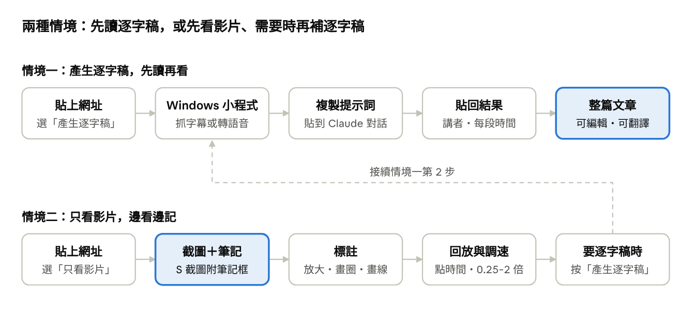
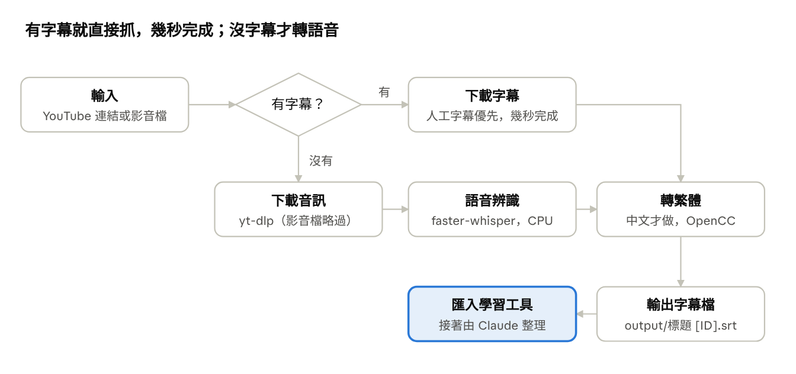
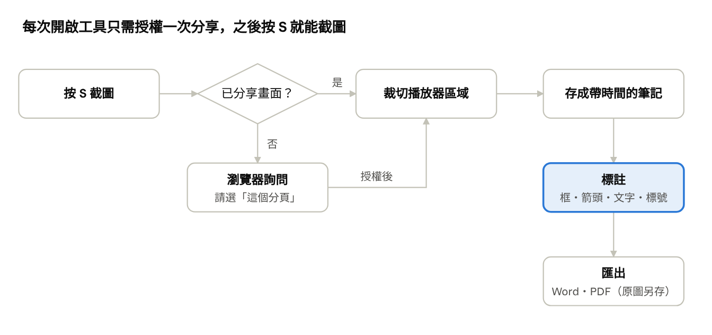
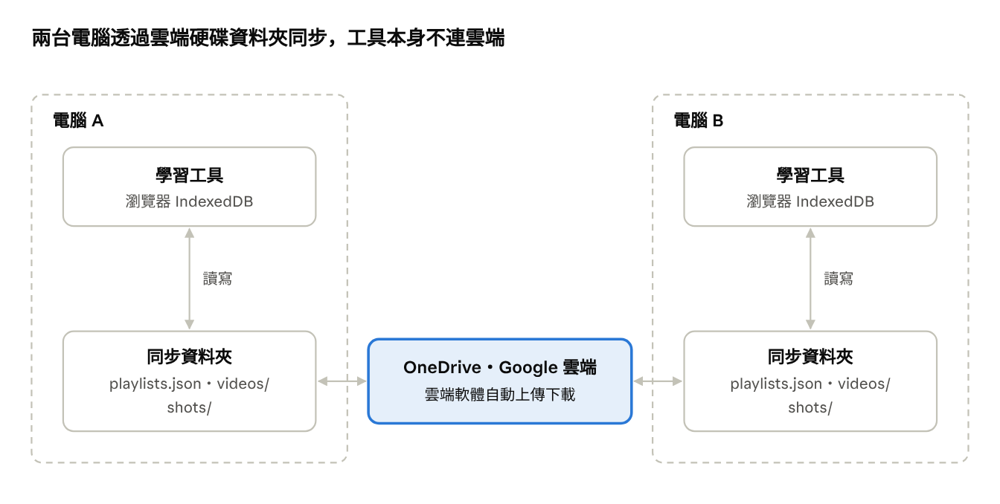

# YouTube 教學影片學習工具｜需求與規格文件

Nov 25, 2026 · @Peilan

## 1. 概述

本工具讓使用者貼上 YouTube 教學影片連結後，邊看邊讀整理好的逐字稿、記筆記、截圖並標註重點，最後匯出成 Word 或 PDF。v2 要補上「沒有字幕的影片」的語音轉文字能力，並加入截圖標註與 Word / PDF 匯出。

**範圍**

- 一個在電腦瀏覽器開啟的學習工具，資料存在瀏覽器，並可透過雲端硬碟資料夾在多台 Windows 電腦間同步。

- 一組 Windows 小程式：自動抓取 YouTube 字幕，沒有字幕時語音轉文字，產生字幕檔後匯入工具。

- 不含：手機版、多人協作。

**版本**

| 版本 | 日期                    | 內容                                                                                         |
|------|-------------------------|----------------------------------------------------------------------------------------------|
| v1   | 2026-11-17              | 播放、逐字稿整理（標點、分段、雙語、A/B 講者）、筆記、播放清單、截圖                         |
| v2   | 2026-11-26 定稿，開發中 | 自動抓字幕與語音轉文字（Windows 小程式 + 瀏覽器內辨識）、截圖標註、匯出 Word / PDF、雲端同步 |

## 2. 使用者與使用情境

使用者是一位個人學習者，在 Windows 電腦上看 15–30 分鐘的中英文教學影片，需要看清楚操作步驟並留下筆記。

| 項目     | 條件                                                                                       |
|----------|--------------------------------------------------------------------------------------------|
| 影片語言 | 英文、中文                                                                                 |
| 影片長度 | 通常 15–30 分鐘，上限 60 分鐘                                                              |
| 講者     | 多為單人講解，偶有兩人對談                                                                 |
| 作業系統 | Windows 10 / 11                                                                            |
| 硬體     | 無獨立顯示卡（只用 CPU，或內顯的 WebGPU）                                                  |
| 瀏覽器   | 電腦版 Chrome 或 Edge                                                                      |
| 操作習慣 | 可接受「先跑小程式、再匯入結果」                                                           |
| 使用人數 | 2 人各自在自己的電腦使用，內容不共享；工具不做登入，資料隨電腦分開，各自選自己的同步資料夾 |

**兩種使用情境**

兩種使用情境 · 各 5 步，情境二可隨時接到情境一

貼網址時二選一：「產生逐字稿」走情境一；「只看影片」走情境二，之後隨時可按鈕補產生逐字稿。逐字稿為半自動、免費：由 Windows 小程式取得字幕，再複製提示詞到 Claude 對話整理。

## 3. 功能需求總表

v2 新增 F7–F12 六項，並調整 F2 的繁體轉換。優先級 P1 = 本版必做，P2 = 本版盡量做。

| 編號 | 功能                 | 說明                                                                                                                                                                                                                                                                                                                                                                                                                       | 版本    | 優先級 |
|------|----------------------|----------------------------------------------------------------------------------------------------------------------------------------------------------------------------------------------------------------------------------------------------------------------------------------------------------------------------------------------------------------------------------------------------------------------------|---------|--------|
| F1   | 播放清單管理         | 新增、改名、刪除、排序清單；內建「未分類」為預設清單（不可刪除，刪除其他清單時其影片可移入未分類）；貼網址加入影片時選「產生逐字稿」或「只看影片」；影片改名、刪除、排序、搬移                                                                                                                                                                                                                                             | v1      | —      |
| F2   | 逐字稿整理           | 加標點、分段、每段時間標記；保留原文；按「翻譯」才產生中文（同樣用複製提示詞），之後可切換原文 / 雙語 / 中文；簡體自動轉繁體                                                                                                                                                                                                                                                                                               | v1 / v2 | P1     |
| F3   | 講者標記             | 依內容標 A / B（至 D），可點標籤修正、可改名                                                                                                                                                                                                                                                                                                                                                                               | v1      | —      |
| F4   | 筆記                 | 依時間記筆記、引用逐字稿、點時間跳回影片                                                                                                                                                                                                                                                                                                                                                                                   | v1      | —      |
| F5   | 截圖                 | 一鍵擷取播放器畫面，自動存成帶時間的筆記；每張截圖附筆記框，截圖後立刻出現並可直接打字（Enter 儲存、Esc 略過），「截圖後暫停影片」預設勾選、可取消；之後隨時可改                                                                                                                                                                                                                                                           | v1      | —      |
| F6   | 備份與 Markdown 匯出 | JSON 全量備份 / 還原；單部影片匯出 .md                                                                                                                                                                                                                                                                                                                                                                                     | v1      | —      |
| F7   | 自動取得逐字稿       | Windows 小程式先自動抓 YouTube 字幕，沒有字幕才語音轉文字；瀏覽器內辨識為備援。產生帶時間字幕再走 F2 整理                                                                                                                                                                                                                                                                                                                  | v2      | P1     |
| F8   | 截圖標註             | 畫框、箭頭、文字，可復原、可還原原圖                                                                                                                                                                                                                                                                                                                                                                                       | v2      | P1     |
| F9   | 匯出 Word / PDF      | 筆記、截圖、逐字稿可勾選，匯出 .docx 或列印成 PDF                                                                                                                                                                                                                                                                                                                                                                          | v2      | P1     |
| F10  | 雲端同步             | 透過 OneDrive / Google 雲端硬碟資料夾，在多台 Windows 電腦間同步清單、逐字稿、筆記、截圖                                                                                                                                                                                                                                                                                                                                   | v2      | P1     |
| F11  | 播放控制             | 速度 0.25 / 0.5 / 1 / 1.5 / 2 倍；前後跳 5 秒；點逐字稿、筆記、截圖的時間回到該處播放                                                                                                                                                                                                                                                                                                                                      | v2      | P1     |
| F12  | 整篇文章閱讀         | 按「整篇文章」把逐字稿排成文章：依主題自動分段、每段開頭有時間（點了從該處播放）、講者寫在段內；可切換原文 / 雙語 / 中文、複製全文、匯出 Word / PDF；右側小播放器可繼續截圖與記筆記。文章可直接編輯：修改或刪除文字、刪除 / 合併 / 切分段落、插入「我的補充」段落（不同底色區分）；自動儲存、可復原 / 重做；編輯另存一份，不動到原始逐字稿，可隨時「還原原始逐字稿」；編輯過的段落，中文翻譯標示「原文已修改」並可重新翻譯 | v2      | P1     |

## 4. F7-a Windows 小程式：自動抓字幕與語音轉文字

小程式輸入 YouTube 連結或本機影音檔，輸出一個帶時間的 .srt 字幕檔，再從工具的「匯入逐字稿」上傳。全程在使用者電腦本機執行，免費。

**先抓字幕、再轉語音**：YouTube 連結會先用 yt-dlp 抓現成字幕（優先人工字幕，其次自動產生字幕），幾秒內完成；抓不到才下載音訊轉文字。字幕以 VTT 下載後由程式轉成 SRT，不需要 ffmpeg。自動字幕品質太差時，可選「強制語音辨識」。

**減少手動步驟**：工具按「產生逐字稿」時自動複製影片網址；雙擊 transcribe.bat 時若剪貼簿是 YouTube 網址，直接詢問「要處理這部影片嗎？」。工具在第一次使用時選一次 transcriber/output 資料夾，之後自動偵測該影片的新字幕檔並帶入，不用手動上傳。

**貼網址時先偵測字幕**：加入影片視窗載入影片後，用 YouTube 播放器回報的字幕資訊判斷有無字幕（含自動產生字幕），顯示三種結果：

| 結果     | 畫面提示                                                                                                                         |
|----------|----------------------------------------------------------------------------------------------------------------------------------|
| 有字幕   | 「這部影片有字幕（語言）」，產生逐字稿只需幾秒；未裝小程式也可手動複製轉錄稿                                                     |
| 沒有字幕 | 黃色提醒「這部影片沒有字幕」，列出三種做法：① 用 Windows 小程式自動轉語音（附安裝說明）② 上傳聲音檔用瀏覽器辨識 ③ 先「只看影片」 |
| 無法判斷 | 「暫時無法判斷有無字幕」，按「產生逐字稿」後由小程式自動處理                                                                     |

偵測不需任何金鑰；YouTube 未回報字幕資訊時一律顯示「無法判斷」，不猜。偵測方式的可靠度需在開發初期實測（風險 R9）。

小程式處理流程 · 6 步

**交付檔案（打包成一個 zip）**

| 檔案           | 用途                                         |
|----------------|----------------------------------------------|
| install.bat    | 一次性安裝：檢查 Python、安裝套件、安裝 Deno |
| transcribe.bat | 日常使用：雙擊後貼連結，或把影音檔拖到它上面 |
| transcribe.py  | 主程式                                       |
| 使用說明.txt   | 安裝與操作步驟                               |

**組成元件**

- Python 3.12（使用者自行從 python.org 安裝，勾選 Add to PATH）。

- yt-dlp\[default\]：下載音訊。YouTube 自 2025.11 起需要 JavaScript 執行環境，故另裝 Deno（用 winget）。

- faster-whisper：CPU int8 語音辨識，內建解碼，不需另裝 ffmpeg。

- opencc：簡體轉台灣繁體（s2twp）。

**操作流程**

1.  雙擊 transcribe.bat，貼上一個或多個 YouTube 連結（也接受播放清單連結），或直接把影音檔拖到 bat 上。

2.  選語言：自動 / 英文 / 中文。

3.  選模式：快速（small）或準確（large-v3-turbo）。預設：英文用快速，中文用準確。

4.  畫面顯示進度條與預估剩餘時間。

5.  完成後在 output 資料夾產生 影片標題 \[影片ID\].srt，並自動開啟該資料夾。

**辨識設定**

- 開啟 VAD（過濾靜音），減少無中生有的文字。

- 中文時加入提示詞「以下是繁體中文的句子。」，再用 OpenCC 轉繁體，雙重保障。

- 處理時間未實測，依 CPU 而定；估計 30 分鐘影片快速模式約 10 分鐘、準確模式約 20–40 分鐘（估計值，待驗收時實測）。

- 第一次使用會下載模型（small 約 0.5 GB、turbo 約 1.6 GB），之後不再下載。

**錯誤處理**：找不到 Python、下載失敗（提示更新 yt-dlp 或確認 Deno）、檔案無法解碼，皆以中文訊息說明下一步。

## 5. F7-b 瀏覽器內語音辨識

工具的匯入視窗新增「上傳音檔 / 影片檔 → 語音辨識」，不必安裝任何程式；定位為備援，準確度與速度低於 Windows 小程式。

- **輸入**：使用者自己的 mp3 / m4a / mp4 / webm 檔，最長 60 分鐘。

- **引擎**：Transformers.js 4.x 執行 Whisper。有 WebGPU（內顯即可）就用 WebGPU，否則用 WASM。

- **模型**：快速 whisper-base、準確 whisper-small；第一次使用時下載並快取在瀏覽器。

- **處理**：解碼成 16 kHz 單聲道，每 5 分鐘一個區塊依序辨識，顯示「第 N / M 區塊」進度，可中途取消。

- **執行位置**：在 Web Worker 裡跑，辨識時頁面仍可操作。

- **輸出**：與貼上的字幕相同格式（時間 + 文字），接著走 F2 整理流程。

- **前提**：需用 http://localhost 開啟工具（直接開檔案時瀏覽器可能無法快取模型）。

## 6. F8 截圖標註

在截圖放大視窗按「標註」進入編輯模式，用滑鼠在圖上畫重點，存檔後取代筆記裡的圖。

截圖到標註流程 · 6 步、1 個判斷

| 工具     | 操作                                   |
|----------|----------------------------------------|
| 方框     | 拖曳畫出空心矩形                       |
| 箭頭     | 從起點拖到終點                         |
| 文字     | 點一下輸入文字，帶白底方便閱讀         |
| 螢光筆   | 半透明實心矩形，標出一區塊             |
| 數字標號 | 點一下放入 ①②③，自動遞增，對應操作步驟 |
| 圈圈     | 拖曳畫出空心橢圓                       |
| 線條     | 拖曳畫直線；按住 Shift 畫水平或垂直線  |

- 顏色：紅、橙、黃、綠、藍 5 色；線寬：細 / 中 / 粗。

- 「復原」可逐步撤銷（Ctrl+Z），「清除全部」回到未標註狀態。

- 第一次標註時保留原圖，之後隨時可「還原原圖」。

- 標註以原始解析度輸出，不因畫面縮放而模糊。

## 7. F9 匯出 Word / PDF

「匯出」選單一次匯出目前影片，使用者先勾選要包含的內容。

- **內容選項**：筆記 / 截圖（含標註）/ 逐字稿；逐字稿可選雙語、只原文、只中文。

- **文件結構**：標題 → 影片連結與匯出日期 → 筆記（依時間，截圖緊接在對應筆記下）→ 逐字稿（時間、講者、段落）。

- **時間戳**：每個時間都是可點的 YouTube 連結，直接跳到該秒。

- **Word**：在瀏覽器內產生 .docx（docx 函式庫），圖片嵌入、寬度貼齊頁面、中文字型正常。

- **PDF**：開啟排版好的列印頁，使用者在列印視窗選「另存為 PDF」。圖片不跨頁切斷。

- 保留 v1 的 Markdown 匯出。

## 8. F10 雲端同步

同步交給電腦上已安裝的 OneDrive 或 Google 雲端硬碟軟體：工具只讀寫你指定的本機資料夾，不需要申請任何帳號設定。

雲端同步 · 2 台電腦共用 1 個雲端硬碟資料夾

- **設定**：每台電腦第一次在「設定 → 雲端同步」選同一個雲端硬碟資料夾（例如 OneDrive\影片學習同步）。之後開啟工具時，瀏覽器可能要求按一次「允許」。

- **檔案格式**：playlists.json、每部影片一個 videos/\<id\>.json、每張截圖一個 shots/\<id\>.png；只寫有變動的檔案。

- **同步時機**：開啟工具與切回分頁時讀取；資料變更後 5 秒內寫入；畫面顯示「上次同步時間」。

- **合併規則**：清單、每則筆記、每部影片的逐字稿都帶更新時間；兩台都改過時逐筆合併，同一筆取較新的。刪除以「刪除記號」同步，30 天後清除。

- **開啟方式不影響**：用 GitHub Pages 或 start.bat 開啟，只要指向同一個資料夾，資料就一致。

- **限制**：需用 Chrome / Edge；避免兩台電腦同時編輯同一則筆記；API 金鑰不寫入同步資料夾。

## 9. 非功能需求

各項品質要求集中於此；細節見「系統架構與品質規範」與「資安規範」。標「建議值」的數字請你確認。

| 編號   | 類別           | 需求                                                                                                      | 驗證方式         |
|--------|----------------|-----------------------------------------------------------------------------------------------------------|------------------|
| NFR-01 | 效能（工具）   | 60 分鐘影片逐字稿（約 600 段）1 秒內顯示；按 S 到出現截圖與筆記框 1 秒內；匯出含 30 張截圖的 Word 10 秒內 | Windows 實測     |
| NFR-02 | 效能（小程式） | 有字幕影片 30 秒內產生 .srt；30 分鐘無字幕影片快速模式約 10 分鐘（建議值，待實測）                        | Windows 實測     |
| NFR-03 | 相容性         | Windows 10 / 11；Chrome、Edge 最新兩版；視窗寬 1280 px 以上為主要版面，窄於 1100 px 改上下排列            | 實測             |
| NFR-04 | 易用性         | 常用動作有快捷鍵（空白、←→、S、N、Ctrl+Z）；介面與錯誤訊息全為繁體中文並說明下一步；刪除前確認            | 驗收檢查         |
| NFR-05 | 無障礙         | 文字對比達 WCAG AA；所有按鈕有文字或提示；可只用鍵盤操作主要功能                                          | 瀏覽器無障礙檢查 |
| NFR-06 | 可靠性         | 變更 1 秒內存入瀏覽器；未開同步且 7 天未備份時提醒；資料格式升級前自動備份；關閉分頁不遺失已輸入的筆記    | 單元測試＋實測   |
| NFR-07 | 容量           | 至少 200 部影片、2,000 張截圖仍可正常使用（建議值）                                                       | 用測試資料實測   |
| NFR-08 | 資安與隱私     | 資料預設不離開電腦；API 金鑰不進備份、同步資料夾與 Git；全部外來內容跳脫顯示                              | 資安檢查清單     |
| NFR-09 | 可維護性       | 模組化、純計算函式有單元測試、Conventional Commits、文件與程式一致                                        | 完成定義         |
| NFR-10 | 安裝與部署     | 工具免安裝（GitHub Pages 網址）；小程式一次安裝 10 分鐘內、不需系統管理員權限                             | 新電腦實測（A1） |
| NFR-11 | 成本           | 無固定月費；主要流程不需付費 API                                                                          | 設計檢查         |
| NFR-12 | 授權與合規     | 僅供個人學習；第三方套件授權允許公開儲存庫使用；使用說明提醒 YouTube 使用條款                             | 發佈前檢查       |

## 10. 驗收標準

以下全部通過才算 v2 完成；由使用者在自己的 Windows 電腦實測。

- [ ] A1 在一台沒裝過的 Windows 上，依「使用說明」10 分鐘內完成小程式安裝。

- [ ] A2 一部 20 分鐘英文影片，小程式產生 .srt，匯入後時間軸與影片對齊（誤差 2 秒內）。

- [ ] A3 一部中文影片，輸出為繁體字。

- [ ] A4 瀏覽器內辨識可完成一個 15 分鐘音檔，過程中頁面不卡住。

- [ ] A5 兩人對談影片整理後有 A / B 兩種講者標籤。

- [ ] A6 截圖可畫框、箭頭、文字、復原、還原原圖，重開頁面後標註仍在。

- [ ] A7 匯出的 .docx 用 Word 開啟正常，圖片與中文皆正確。

- [ ] A8 匯出的 PDF 圖片不被切開、時間連結可點。

- [ ] A9 通過「資安規範」分頁的發佈前檢查清單。

<!-- -->

- [ ] A10 一部有字幕的英文影片，小程式 30 秒內產生 .srt（不經語音辨識）。

- [ ] A11 兩台 Windows 電腦指向同一個雲端硬碟資料夾，A 電腦新增的筆記與截圖，在 B 電腦重新開啟工具後出現。

<!-- -->

- [ ] A12 播放速度可切換 0.25 / 0.5 / 1 / 1.5 / 2 倍。

- [ ] A13 整理後的逐字稿為原文、每段有時間與講者；按「翻譯」後出現中文。

- [ ] A14 「只看影片」加入的影片，之後按「產生逐字稿」可補上逐字稿，既有筆記與截圖不受影響。

<!-- -->

- [ ] A15 貼上無字幕影片時，加入影片視窗顯示「這部影片沒有字幕」與三種做法；有字幕影片顯示「有字幕」。

<!-- -->

- [ ] A16 按「整篇文章」後顯示依主題分段的文章，每段有時間，點時間從該處播放；不需要再複製一次提示詞。修改、刪除、加入自己的文字後關閉再開，內容仍在；「還原原始逐字稿」可回到未編輯狀態。

<!-- -->

- [ ] A17 按 S 截圖後，筆記區立即出現該截圖與一個已可輸入的筆記框；輸入後按 Enter 儲存。

## 11. 已確認決策

| 問題                  | 決定（2026-11-25）                              | 對開發的影響                                                                              |
|-----------------------|-------------------------------------------------|-------------------------------------------------------------------------------------------|
| GitHub 帳號           | 有                                              | 公開儲存庫（2026-11-26 確認），工具可用 GitHub Pages 固定網址開啟；筆記仍只存在你的瀏覽器 |
| Python                | 應該有裝，版本未知                              | install.bat 先檢查版本，低於 3.11 就提示升級                                              |
| 逐字稿整理方式        | 主要用「複製提示詞到 Claude」                   | 此流程做成預設且最順；API 一鍵整理保留為選用，金鑰保護維持「資安規範」3.1                 |
| 截圖馬賽克            | 不需要                                          | 不列入 F8                                                                                 |
| 自動抓取 YouTube 字幕 | 只在 Windows 小程式做（2026-11-26）             | 工具本身不抓字幕；小程式先抓字幕、沒有才轉語音                                            |
| 雲端同步              | 雲端硬碟資料夾，多台 Windows 電腦（2026-11-26） | 新增 F10；不需申請任何雲端帳號設定                                                        |
| 逐字稿自動化程度      | 半自動、免費（2026-11-26）                      | 不做本機小幫手與 API 全自動；以自動複製網址、自動帶入字幕減少步驟                         |
| 逐字稿產生時機        | 貼網址時二選一（2026-11-26）                    | 「產生逐字稿」或「只看影片」，後者可隨時補產生                                            |
| 播放速度              | 0.25 / 0.5 / 1 / 1.5 / 2 倍（2026-11-26）       | 新增 F11                                                                                  |
| 翻譯                  | 按鈕才翻（2026-11-26）                          | F2 整理只輸出原文；翻譯另一個提示詞                                                       |
| 預設清單              | 「未分類」（2026-11-26）                        | 加入影片時預設選它；不可刪除；下拉選單也可直接新增清單                                    |
| 整篇文章              | 新增 F12（2026-11-26）                          | Claude 整理時在同一個提示詞裡標出文章分段點（JSON 欄位 para），不增加手動步驟             |

**文件管理**

- 文件正本：線上 Claude Docs（2026-11-26 確認）。每次修改後匯出 Markdown（含圖）與 Word 到專案資料夾 docs/。
