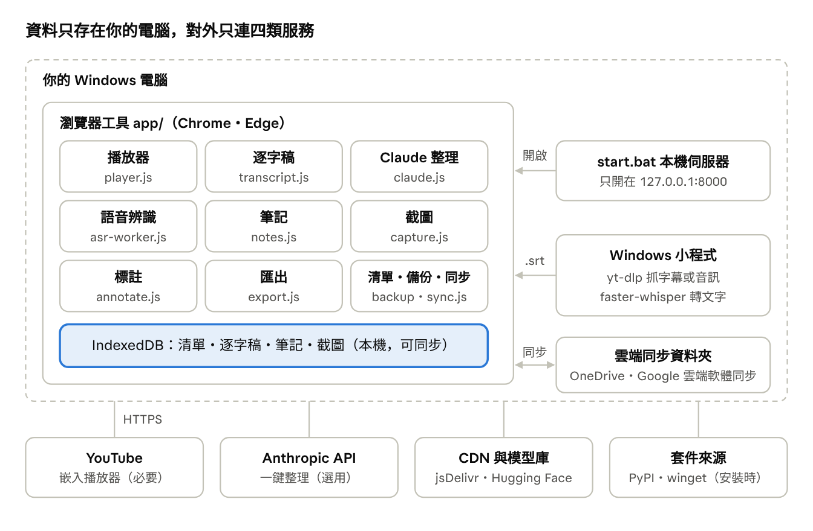

# 系統架構與品質規範

Nov 25, 2026 · @Peilan

## 1. 架構總覽

系統架構 · 9 個瀏覽器模組、2 個本機程式、4 類外部服務

虛線框是你的電腦：瀏覽器工具與 Windows 小程式都在本機執行，小程式產生的 .srt 由你匯入工具；框外是會連線的外部服務。

## 2. 元件說明

v2 把 v1 的單一 HTML 拆成多個模組，用瀏覽器原生 ES Modules，不需要建置步驟；由 start.bat 在本機啟動伺服器開啟。

**瀏覽器工具（app/）**

| 模組                         | 職責                                                    |
|------------------------------|---------------------------------------------------------|
| index.html + css/app.css     | 頁面結構與樣式                                          |
| js/app.js                    | 啟動、分頁切換、快捷鍵、串接各模組                      |
| js/store.js                  | IndexedDB 讀寫，唯一碰儲存的模組                        |
| js/playlist.js               | 播放清單與影片管理（F1）                                |
| js/player.js                 | 包裝 YouTube IFrame API：播放、跳轉、速度、目前時間     |
| js/transcript.js             | 字幕解析、逐字稿顯示與編輯、講者（F2、F3）              |
| js/claude.js                 | 組提示詞、解析回覆、呼叫 Anthropic API                  |
| js/asr.js + js/asr-worker.js | 瀏覽器內語音辨識（F7-b），Worker 內執行                 |
| js/notes.js                  | 筆記（F4）                                              |
| js/capture.js                | 畫面擷取與裁切（F5）                                    |
| js/annotate.js               | 截圖標註編輯器（F8）                                    |
| js/export.js                 | 匯出 Markdown / Word / PDF（F6、F9）                    |
| js/backup.js                 | 備份與還原（F6）                                        |
| js/util.js                   | 時間格式、跳脫字元、下載等共用函式                      |
| js/sync.js                   | 雲端同步：讀寫使用者選的雲端硬碟資料夾、逐筆合併（F10） |

**Windows 小程式（transcriber/）**：install.bat、transcribe.bat、transcribe.py、requirements.txt（版本鎖定），規格見需求規格第 4 節。

**啟動器**：根目錄 start.bat 執行 py -m http.server 8000 --bind 127.0.0.1，並開啟 http://localhost:8000/app/。只綁定本機位址，區網內其他電腦連不到。

## 3. 資料模型與儲存

所有資料存在使用者瀏覽器的 IndexedDB（資料庫 ytStudy，v2 升級為第 2 版），不上傳到任何伺服器。

| 儲存區    | 內容                                      | 說明                                |
|-----------|-------------------------------------------|-------------------------------------|
| kv        | state：播放清單、影片、逐字稿、筆記、設定 | 一份 JSON，每次變更後 300 ms 內寫入 |
| shots     | 截圖（含標註的合成圖）PNG Blob            | 顯示與匯出用                        |
| shotsOrig | 未標註的原圖 PNG Blob（v2 新增）          | 「還原原圖」與重新編輯標註用        |

**state 結構**

{  
"schema": 2,  
"playlists": \[{ "id": "…", "name": "Excel 教學", "videos": \["videoId"\], "collapsed": false }\],  
"videos": {  
"videoId": {  
"ytId": "dQw4w9WgXcQ", "title": "…", "speakers": { "A": "講者 A" },  
"segs": \[{ "t": 12.5, "sp": "A", "text": "原文", "zh": "中文" }\],  
"notes": \[{ "id": "…", "t": 95, "text": "…", "shotId": "…", "ann": \[{ "type": "rect", "x": 10, "y": 20, "w": 100, "h": 50, "color": "#e11d48", "width": 4 }\] }\]  
}  
},  
"current": "videoId",  
"settings": { "model": "…", "lang": "繁體中文（台灣用語）", "view": "bi" }  
}

- 標註以圖形清單 ann 儲存（座標為原圖像素），所以可以重新編輯，不會把筆畫烙死在原圖上。

- API 金鑰不放在 state，另存，見「資安規範」。

- 升級：讀到 schema 缺少或為 1 的資料時自動轉換，轉換前先備份一份在 kv 的 state_v1_backup。

- 備份檔：一個 JSON，含 state 與所有圖片（Base64），不含 API 金鑰。

**同步資料夾（F10）**：playlists.json、videos/\<id\>.json、shots/\<id\>.png、shots-orig/\<id\>.png。清單、影片、筆記皆加 updatedAt（毫秒時間）與 deleted（刪除記號）欄位，合併時逐筆比較 updatedAt。資料夾權限以 File System Access API 的資料夾控制代碼存在 IndexedDB kv 的 syncDir。

## 4. 外部服務與相依套件

所有套件鎖定版本（查詢日 2026-11-25），升級需走「專案管理」的變更流程。

| 元件                                 | 版本                                       | 來源               | 用途                   | 必要性     |
|--------------------------------------|--------------------------------------------|--------------------|------------------------|------------|
| YouTube IFrame Player API            | 由 YouTube 提供                            | youtube.com        | 嵌入播放               | 必要       |
| Anthropic Messages API               | 2023-06-01 介面版                          | api.anthropic.com  | 一鍵整理逐字稿         | 選用       |
| Transformers.js                      | 4.3.2                                      | cdn.jsdelivr.net   | 瀏覽器內 Whisper       | 選用       |
| Whisper 模型（ONNX）                 | onnx-community/whisper-base、whisper-small | huggingface.co     | 瀏覽器內辨識           | 選用       |
| docx                                 | 9.16.0                                     | cdn.jsdelivr.net   | 產生 .docx             | 匯出時載入 |
| Python                               | 3.12.x                                     | python.org         | 小程式、本機伺服器     | 必要       |
| yt-dlp（含 yt-dlp-ejs）              | 2026.11.23（ejs 0.8.0）                    | PyPI               | 下載音訊               | 小程式     |
| Deno                                 | 安裝當時最新穩定版                         | winget             | yt-dlp 解 YouTube 驗證 | 小程式     |
| faster-whisper                       | 1.2.1                                      | PyPI               | 本機語音辨識           | 小程式     |
| opencc-python-reimplemented          | 0.1.7                                      | PyPI               | 簡轉繁                 | 小程式     |
| OneDrive / Google 雲端硬碟（電腦版） | 使用者已安裝的版本                         | Microsoft / Google | 同步資料夾上傳下載     | 同步時     |

yt-dlp 跟著 YouTube 變動更新很頻繁，是唯一允許「下載失敗時先升級再回報」的套件。

## 5. 技術限制與設計決策

| 編號  | 決策                                                                         | 理由                                                                | 代價                                                 |
|-------|------------------------------------------------------------------------------|---------------------------------------------------------------------|------------------------------------------------------|
| ADR-1 | 用 GitHub Pages 網址或本機伺服器開啟，不用 Claude 網頁版平台                 | 平台禁止嵌入其他網站與螢幕擷取；直接開檔案 YouTube 會回「錯誤 153」 | 需先執行 start.bat                                   |
| ADR-2 | 工具本身不抓 YouTube 字幕，由 Windows 小程式用 yt-dlp 抓（沒有字幕才轉語音） | 瀏覽器跨網域限制，且 YouTube 未提供公開字幕介面                     | 需先執行小程式再匯入                                 |
| ADR-3 | 截圖用螢幕分享 API 擷取本分頁再裁切                                          | YouTube 播放器在跨網域 iframe 中，無法直接讀取畫面                  | 每次開啟需授權一次；解析度受視窗大小限制             |
| ADR-4 | 不用框架、不建置，原生 ES Modules                                            | 單人專案，減少工具鏈與供應鏈風險                                    | 大型 UI 較難維護                                     |
| ADR-5 | 講者由 Claude 依內容判斷，不做聲紋分離                                       | 聲紋分離（pyannote）需要額外模型授權與較強硬體                      | 兩人聲音交錯處可能標錯，可手動修正                   |
| ADR-6 | 小程式用 CPU int8 量化                                                       | 使用者無獨立顯示卡                                                  | 準確模式較慢                                         |
| ADR-7 | 資料存本機瀏覽器，跨電腦靠雲端同步資料夾                                     | 隱私，無需帳號與伺服器                                              | 未開同步時，清除瀏覽器資料會遺失，需定期備份         |
| ADR-8 | 雲端同步用雲端硬碟資料夾（File System Access API），不直接連雲端 API         | 不需申請 OAuth、不需伺服器；使用者已有 OneDrive / Google 雲端硬碟   | 只支援 Chrome / Edge；兩台同時編輯同一筆時較新者勝出 |

## 6. 品質規範

**程式碼風格**

- JavaScript：ES2022、"use strict" 模組、Prettier 預設格式（縮排 2、單引號）、公開函式寫 JSDoc。

- Python：PEP 8，用 ruff 檢查與格式化，函式加型別註記。

- 命名用英文，介面文字與錯誤訊息用繁體中文。

- 一個函式只做一件事；純計算（解析、格式化）與畫面操作分開，方便測試。

- 一律用 textContent 或跳脫後的字串產生畫面，細節見「資安規範」。

**測試**

| 層級               | 工具                     | 範圍                                                       | 何時執行       |
|--------------------|--------------------------|------------------------------------------------------------|----------------|
| 單元測試（JS）     | node --test              | 字幕解析、時間格式、提示詞與 JSON 解析、備份格式、資料升級 | 每次 commit 前 |
| 單元測試（Python） | pytest                   | SRT 輸出、繁體轉換、參數解析                               | 每次 commit 前 |
| 手動測試           | 需求規格「驗收標準」清單 | 播放、截圖、辨識、匯出                                     | 每次發佈前     |

**相容性**：Windows 10 / 11；Chrome、Edge 最新兩個版本；視窗寬 1280 px 以上為主要版面，窄於 1100 px 改上下排列。

**效能目標**

| 項目                               | 目標                   |
|------------------------------------|------------------------|
| 60 分鐘影片逐字稿（約 600 段）顯示 | 1 秒內                 |
| 截圖從按鍵到出現在筆記             | 1 秒內（已授權分享後） |
| 標註編輯器拖曳                     | 無明顯延遲             |
| 匯出 30 張截圖的 .docx             | 10 秒內                |

**無障礙與易用**：常用動作都有快捷鍵（空白、←→、S、N、Ctrl+Z）；按鈕有文字或提示；文字對比達 WCAG AA；刪除類動作都要確認。

## 7. 完成定義（Definition of Done）

一個功能只有在以下全部成立時才算完成：

- [ ] 程式碼在功能分支完成，合併回 main（見「Git 版本管理規範」）。

- [ ] 單元測試全部通過，新的純計算函式有對應測試。

- [ ] 對應的驗收項目在 Windows 實測通過。

- [ ] 資安檢查清單通過。

- [ ] 需求規格、架構文件與 CHANGELOG.md 已更新。
