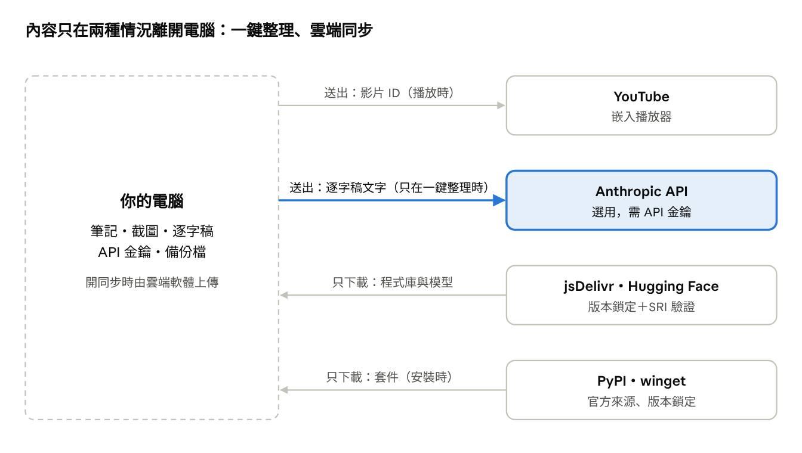
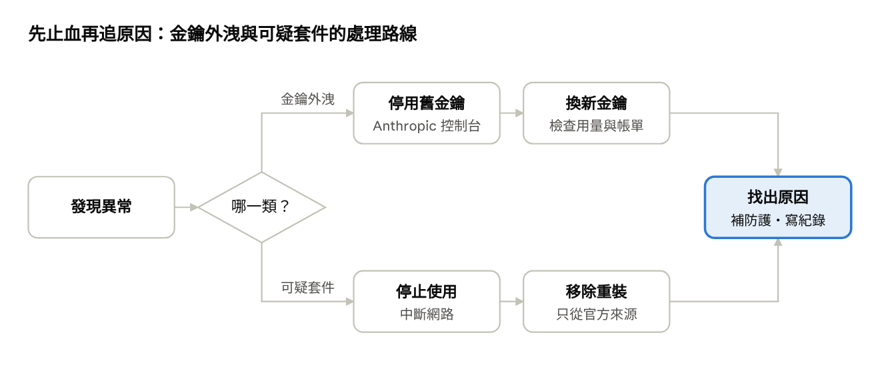

# 資安規範

Nov 25, 2026 · @Peilan

## 1. 資安目標與範圍

本工具只在使用者自己的電腦上執行，資安重點是保護 API 金鑰、防止惡意內容在頁面執行程式碼，以及控管從網路下載的套件。

- **範圍內**：瀏覽器工具、本機伺服器啟動器、Windows 小程式、Git 儲存庫、備份檔、雲端同步資料夾。

- **範圍外**：YouTube、Anthropic、Hugging Face、OneDrive、Google 等外部服務本身的安全；Windows 作業系統與防毒。

- **原則**：資料留在本機、只開必要的對外連線、所有外來內容都當成不可信。

## 2. 資產與威脅分析

| 編號 | 威脅                                                      | 影響資產             | 風險 | 對策（見章節）     |
|------|-----------------------------------------------------------|----------------------|------|--------------------|
| T1   | API 金鑰外洩（頁面被植入腳本、備份檔外傳、誤提交 Git）    | Anthropic 帳號與費用 | 高   | 3.1、3.2、Git 規範 |
| T2   | 逐字稿、Claude 回覆、影片標題、備份檔內含惡意 HTML（XSS） | 金鑰與全部筆記       | 高   | 3.2、3.4           |
| T3   | CDN 腳本被篡改（供應鏈）                                  | 整個頁面             | 中   | 3.3                |
| T4   | Python / 套件來源不明或被冒名                             | 使用者電腦           | 中   | 4                  |
| T5   | 本機伺服器被區網內其他人連入                              | 筆記內容             | 中   | 3.5                |
| T6   | 逐字稿內含對 Claude 的指令（提示詞注入），產生異常內容    | 逐字稿正確性         | 低   | 3.6                |
| T7   | 螢幕分享拍到影片以外的個資                                | 個人隱私             | 低   | 3.7                |
| T8   | 瀏覽器資料被清除導致筆記遺失                              | 全部筆記             | 中   | 3.8                |
| T9   | 同步資料夾被分享給他人、雲端帳號被入侵，或同步檔被篡改    | 筆記、截圖、逐字稿   | 中   | 3.4、3.9           |

## 3. 瀏覽器工具的資安控制

資料流向 · 4 個外部服務，只有 1 個會收到內容

下載類連線不帶使用者資料；唯一送出內容的是使用者主動按「一鍵整理」時送到 Anthropic 的逐字稿。

**3.1 API 金鑰保管**

- 預設只記在本次開啟期間（關閉分頁即消失）；使用者勾選「記住這台電腦」才存入瀏覽器。

- 不放進 state、備份檔、同步資料夾、匯出檔、錯誤訊息與 console。

- 輸入框為密碼欄位，顯示時只露末 4 碼；設定頁提供「清除金鑰」。

- 使用說明建議為本工具建立專用金鑰，並在 Anthropic 控制台設定每月花費上限。

**3.2 防止 XSS**

- 所有外來文字（逐字稿、Claude 回覆、影片標題、筆記、備份檔）只用 textContent 或跳脫後顯示，禁止未跳脫的 innerHTML。

- 頁面加 Content-Security-Policy：腳本只允許本站、YouTube、jsDelivr；連線只允許 Anthropic API、Hugging Face、jsDelivr；禁止行內事件屬性。

- Markdown / Word / PDF 匯出同樣跳脫；列印頁不執行任何外來腳本。

**3.3 第三方腳本**：CDN 程式庫鎖定版本並加 SRI 雜湊（integrity），內容被改動瀏覽器會拒絕載入；只在用到時才載入。

**3.4 匯入檢查**：還原備份時檢查格式與 schema 版本、單檔上限 500 MB、圖片只接受 PNG / JPEG；Claude 回覆只接受符合格式的 JSON 陣列。

**3.5 本機伺服器**：start.bat 只綁定 127.0.0.1，只提供 app/ 資料夾，不提供備份或字幕輸出資料夾。

**3.6 提示詞注入**：提示詞要求 Claude 只輸出 JSON；回覆一律當純文字顯示，不執行、不當連結；使用者可逐段修正。

**3.7 螢幕分享**：只要求分享「這個分頁」；只裁切播放器區域存檔；分享中持續顯示狀態與「停止分享」。

**3.8 資料保存**：超過 7 天未備份時提醒；刪除清單、影片、截圖前都要確認。

**3.9 雲端同步**：只讀寫使用者選的資料夾；API 金鑰不寫入；讀入的同步檔一律經 3.4 的格式檢查、顯示時照 3.2 跳脫。使用說明提醒：雲端帳號開啟兩步驟驗證、不要把同步資料夾分享給他人、同步資料夾不放在 Git 儲存庫內。

## 4. Windows 小程式的資安控制

- **套件來源**：Python 只從 python.org；套件只從官方 PyPI，requirements.txt 鎖定版本；Deno 只用 winget 官方套件 DenoLand.Deno。

- **不需管理員權限**：安裝與執行都以一般使用者身分；程式不修改系統設定。

- **獨立環境**：套件裝在專案內的 .venv，不影響電腦上其他 Python 程式。

- **檔案範圍**：只讀使用者指定的影音檔，只寫入 transcriber/output/；檔名過濾 Windows 不允許的字元。

- **下載的影音只當資料**：不執行、不解壓；完成後可選擇自動刪除音訊檔。

- **不帶帳號憑證**：不讀取瀏覽器 cookies，只下載公開影片；有字幕時只下載字幕文字檔。

## 5. 隱私與著作權注意事項

- 下載 YouTube 影音可能違反 YouTube 使用條款；本工具只供個人學習，由使用者自行判斷。

- 不分享、不上傳下載的音訊、逐字稿與截圖；匯出的 Word / PDF 只供自己使用。

- 用 API 一鍵整理時，逐字稿會送到 Anthropic；主要的「複製提示詞」流程則是使用者自己貼到 Claude 對話。

- Git 儲存庫只放程式碼與文件，不放任何筆記、字幕、音訊或備份檔。

## 6. 資安檢查清單（每次發佈前）

- [ ] 全專案搜尋真實金鑰格式（sk-ant- 後接 20 個字元以上），結果為 0 筆。

- [ ] 新增或修改的畫面程式沒有未跳脫的 innerHTML。

- [ ] CSP 仍在，瀏覽器 console 無 CSP 違規訊息。

- [ ] CDN 腳本版本與 SRI 雜湊未被改動，或改動已經變更流程核准。

- [ ] requirements.txt 仍鎖定版本。

- [ ] start.bat 仍只綁定 127.0.0.1。

- [ ] 備份檔與同步資料夾內都沒有 API 金鑰。

- [ ] .gitignore 涵蓋 output/、.venv/、\*.srt、備份檔。

## 7. 資安事件處理

資安事件處理 · 2 條路線合流

金鑰外洩的征兆：帳單或用量異常、金鑰出現在 Git 歷史或任何檔案。已提交到 Git 的金鑰即使刪掉也視為外洩，一律停用。事件記錄寫在 docs/security-log.md。
