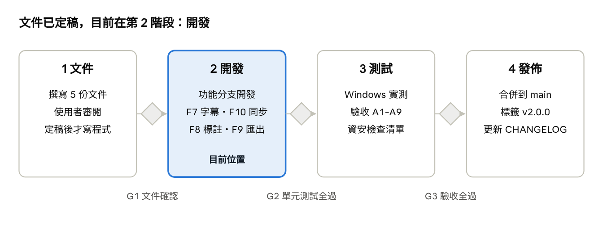
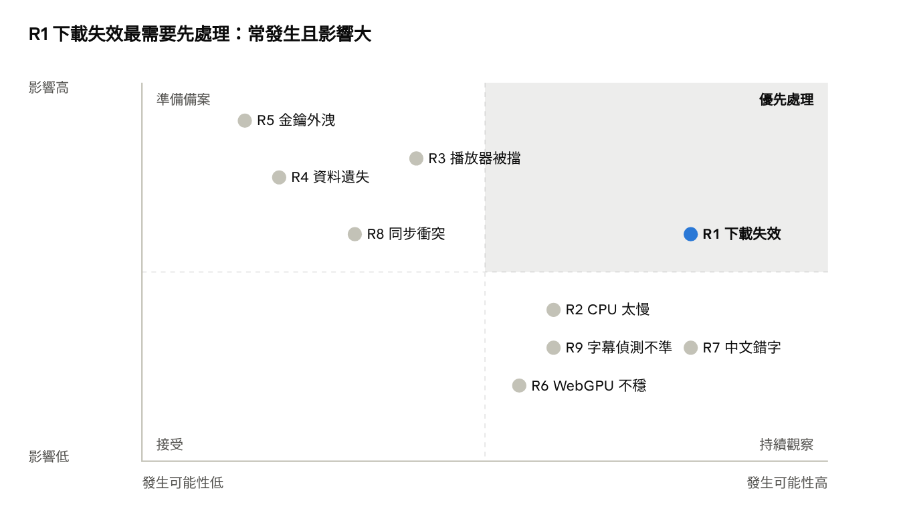
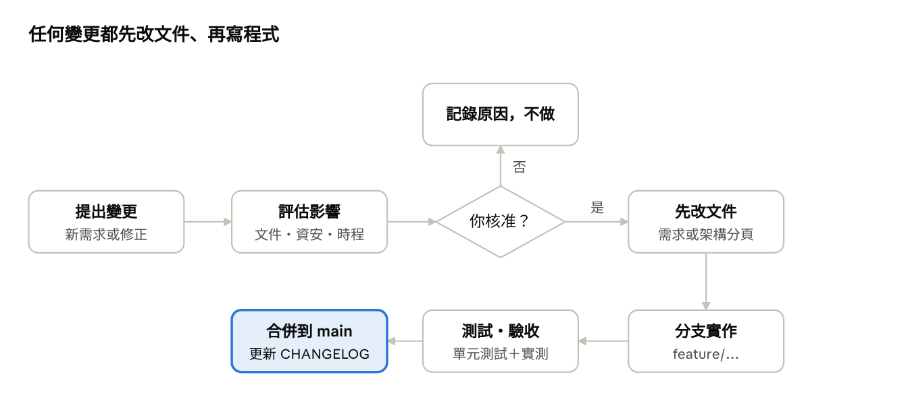

# 專案管理

Nov 25, 2026 · @Peilan

## 1. 專案資訊與角色分工

本專案採文件驅動開發：文件定稿後才寫程式，任何變更先改文件。

| 項目              | 內容                                                                   |
|-------------------|------------------------------------------------------------------------|
| 專案名稱          | YouTube 教學影片學習工具 v2                                            |
| 產品負責人 / 驗收 | 使用者（你）：決定需求優先順序、審閱文件、Windows 實測驗收             |
| 設計與開發        | Claude：撰寫文件、程式、測試、維護 Git                                 |
| 正式文件          | 本文件集（Claude Docs），每次定稿匯出一份 Markdown 到 docs/            |
| 程式碼位置        | C:\Users\USER\Desktop\Claude\影片教學工具（Git 儲存庫），同步到 GitHub |
| 溝通方式          | 此 Claude 對話；文件上的問題直接留言                                   |

## 2. 開發階段與關卡

開發階段與關卡 · 4 階段、3 個關卡

每個關卡都要使用者在對話中確認才進入下一階段；G1 是「文件全部定稿」，已於 2026-11-26 通過。

## 3. 工作分解與任務追蹤

任務依階段排列，狀態欄可直接切換；T02 完成前不開始 T03 之後的工作。

| 編號 | 工作項目                                    | 階段   | 負責   | 對應需求 | 狀態   |
|------|---------------------------------------------|--------|--------|----------|--------|
| T01  | 撰寫 5 份專案文件                           | 1 文件 | Claude | 全部     | 完成   |
| T02  | 文件審閱與定稿                              | 1 文件 | 使用者 | 全部     | 完成   |
| T03  | 建立 Git 儲存庫與目錄結構、匯出文件到 docs/ | 2 開發 | Claude | Git 規範 | 進行中 |
| T04  | v1 拆成 ES Modules、加 start.bat            | 2 開發 | Claude | F1–F6    | 未開始 |
| T05  | Windows 小程式：自動抓字幕＋語音轉文字      | 2 開發 | Claude | F7-a     | 未開始 |
| T06  | 瀏覽器內語音辨識                            | 2 開發 | Claude | F7-b     | 未開始 |
| T07  | 截圖標註編輯器                              | 2 開發 | Claude | F8       | 未開始 |
| T08  | 匯出 Word / PDF                             | 2 開發 | Claude | F9       | 未開始 |
| T09  | 資安措施：CSP、SRI、金鑰保管                | 2 開發 | Claude | 資安規範 | 未開始 |
| T10  | 單元測試（JS + Python）                     | 2 開發 | Claude | 品質規範 | 未開始 |
| T11  | Windows 實測驗收 A1–A9                      | 3 測試 | 使用者 | 驗收標準 | 未開始 |
| T12  | 發佈 v2.0.0                                 | 4 發佈 | Claude | Git 規範 | 未開始 |
| T13  | 雲端同步（同步資料夾、逐筆合併）            | 2 開發 | Claude | F10      | 未開始 |

## 4. 風險登記表

風險矩陣 · 9 項風險依可能性與影響分區

| 編號 | 風險                                       | 對策                                                         |
|------|--------------------------------------------|--------------------------------------------------------------|
| R1   | YouTube 改版，yt-dlp 下載失效              | 先升級 yt-dlp；備案用本機影音檔或瀏覽器內辨識                |
| R2   | CPU 太慢，準確模式等太久                   | 改用快速模式；驗收時先實測一部 30 分鐘影片                   |
| R3   | YouTube 嵌入被擋（錯誤 153 或政策變更）    | 本機伺服器；GitHub Pages 備案                                |
| R4   | 瀏覽器資料被清除，筆記遺失                 | 7 天未備份提醒                                               |
| R5   | API 金鑰外洩                               | 資安規範 3.1；主要流程不用金鑰                               |
| R6   | 內顯 WebGPU 不穩                           | 自動退回 WASM；小程式為主力                                  |
| R7   | Whisper 中文錯字多                         | Claude 整理時修正錯字；中文預設用準確模式                    |
| R8   | 兩台電腦同步衝突，同一則筆記被較新版本覆蓋 | 逐筆合併；覆蓋前的版本留在「衝突備份」；畫面顯示上次同步時間 |
| R9   | YouTube 播放器未回報字幕資訊，字幕偵測不準 | 開發初期先實測；判斷不了時顯示「無法判斷」，交由小程式處理   |

## 5. 變更管理與文件維護

變更管理流程 · 7 步、1 個判斷

- 文件是唯一依據：程式與文件不一致時，以文件為準，先修文件或程式其中一個使其一致。

- 每次關卡通過後，把文件集匯出成 Markdown 放進 docs/ 並 commit，留下版本紀錄。

- 套件升級、新增外部連線、改動 CSP 都算變更，必須走此流程；yt-dlp 緊急升級可先做後補記錄。
