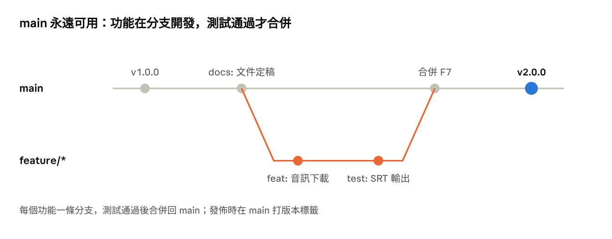

# Git 版本管理規範

Nov 25, 2026 · @Peilan

## 1. 儲存庫與目錄結構

儲存庫就是 C:\Users\USER\Desktop\Claude\影片教學工具 這個資料夾，預設分支 main，遠端 origin 指向你的 GitHub（公開或私人待確認）。

影片教學工具/  
├─ README.md 安裝與使用說明  
├─ CHANGELOG.md 版本紀錄  
├─ .gitignore  
├─ .gitattributes \*.bat 固定 CRLF 換行  
├─ start.bat 啟動本機伺服器並開啟工具  
├─ docs/ 文件集匯出的 Markdown  
│ ├─ 01-需求規格.md  
│ ├─ 02-系統架構與品質規範.md  
│ ├─ 03-資安規範.md  
│ ├─ 04-專案管理.md  
│ ├─ 05-Git版本管理規範.md  
│ └─ security-log.md  
├─ app/ 瀏覽器工具  
│ ├─ index.html  
│ ├─ css/app.css  
│ └─ js/ 各模組（見架構文件）  
├─ transcriber/ Windows 語音轉文字小程式  
│ ├─ install.bat  
│ ├─ transcribe.bat  
│ ├─ transcribe.py  
│ ├─ requirements.txt  
│ └─ output/ 產出字幕（不進 Git）  
├─ tests/ JS 與 Python 單元測試  
└─ legacy/  
└─ yt-study-v1.html v1 原始版本

## 2. 分支策略

分支策略 · main 與功能分支

| 分支                      | 用途                                    | 規則                                       |
|---------------------------|-----------------------------------------|--------------------------------------------|
| main                      | 隨時可用的穩定版                        | 不直接在上面開發；只接受測試通過的合併     |
| feature/\<編號\>-\<名稱\> | 一個功能一條，如 feature/f7-transcriber | 從 main 開出；完成後合併並刪除             |
| docs/\<名稱\>             | 只改文件                                | 同功能分支                                 |
| hotfix/\<名稱\>           | 發佈後的緊急修正                        | 從標籤開出，修完合併回 main 並打修正版標籤 |

## 3. Commit 訊息規範

採用 Conventional Commits：\<類型\>(\<範圍\>): \<摘要\>，摘要用繁體中文、不超過 50 字，一個 commit 只做一件事。

| 類型     | 用途               | 範例                                  |
|----------|--------------------|---------------------------------------|
| feat     | 新功能             | feat(transcriber): 支援播放清單連結   |
| fix      | 修正錯誤           | fix(capture): 修正高 DPI 螢幕裁切偏移 |
| docs     | 只改文件           | docs: 匯出文件集 v2 定稿版            |
| test     | 新增或修改測試     | test(transcript): 覆蓋 SRT 解析       |
| refactor | 不改行為的結構調整 | refactor(app): 拆出 store 模組        |
| security | 資安相關           | security(app): 加入 CSP 與 SRI        |
| chore    | 雜項、套件升級     | chore(deps): yt-dlp 升級到 2026.11.23 |

內文（可省略）說明「為什麼」，並寫上對應的任務編號，例如 Refs: T05。

## 4. 版本號與發佈流程

版本號採 SemVer 主版.次版.修正版，在 main 打 vX.Y.Z 標籤。

| 升哪一碼 | 何時                               | 例子                        |
|----------|------------------------------------|-----------------------------|
| 主版     | 資料或備份格式不相容、操作方式大改 | v1 → v2：拆模組、資料庫升級 |
| 次版     | 新增功能，舊資料可繼續用           | v2.1.0：新增匯出格式        |
| 修正版   | 只修錯誤或升級套件                 | v2.0.1：yt-dlp 緊急升級     |

發佈步驟：

1.  確認專案管理 G3 關卡通過（驗收與資安檢查全過）。

2.  更新 CHANGELOG.md（新增、修正、已知問題）。

3.  匯出文件集到 docs/。

4.  commit 後打標籤：git tag -a v2.0.0 -m "v2.0.0"。

5.  推到 GitHub：git push origin main --tags。

## 5. .gitignore 與機密資料

儲存庫只放程式碼與文件；任何個人資料、產出檔與金鑰都不進 Git。

\# Python 環境與快取  
.venv/  
\_\_pycache\_\_/  
\*.pyc  
  
\# 小程式產出：音訊、字幕  
transcriber/output/  
\*.srt  
\*.vtt  
\*.m4a  
\*.webm  
\*.mp3  
\*.mp4  
  
\# 工具備份與匯出（docs/word/ 的正式文件保留）  
\*備份\*.json  
\*.docx  
!docs/word/\*.docx  
\*.pdf  
  
\# 本機設定與機密  
.env  
\*.key  
  
\# 作業系統雜檔  
Thumbs.db  
Desktop.ini  
.DS_Store

- 安裝 pre-commit 鉤子（放在 scripts/hooks/）：待提交內容含 sk-ant- 就拒絕 commit。

- 金鑰一旦進入 Git 歷史就視為外洩，依「資安規範」第 7 節處理，不靠改寫歷史補救。

- commit 作者用你的 GitHub 名稱與 email，第一次建立儲存庫時確認。儲存庫為公開（2026-11-26 確認），推送前務必通過資安檢查清單。雲端同步資料夾不可放在儲存庫內。
